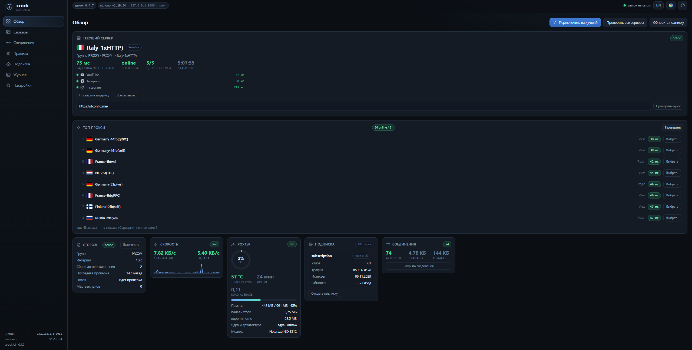
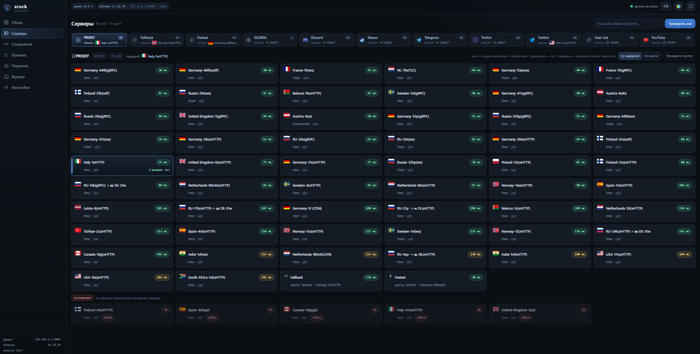
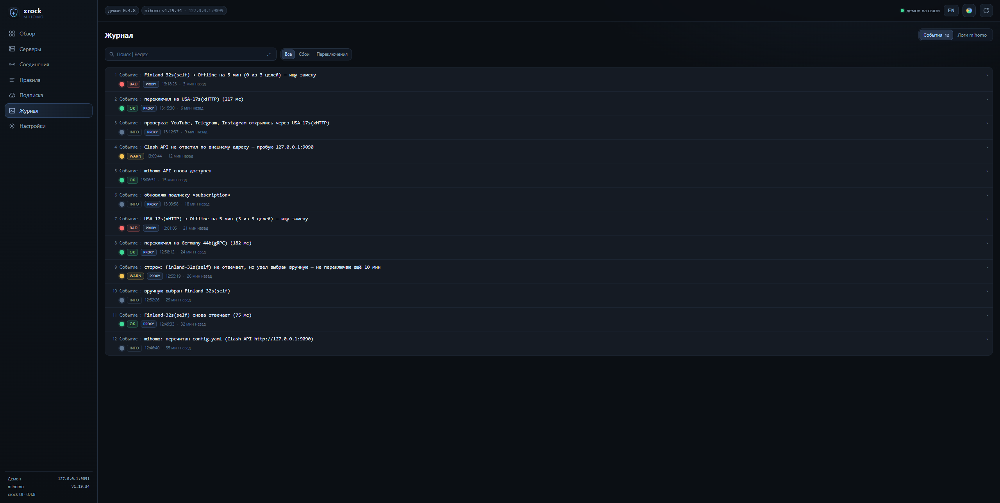

# xrock

Панель для **mihomo** (Clash.Meta) на роутере Keenetic / Netcraze с Entware и XKeen.
С тремя отличиями, из-за которых она и делалась:

1. **Задержка честная — через прокси.** Каждый сервер измеряется так, как через него
   реально идёт трафик: mihomo сам делает запрос через узел, а не меряет TCP-хендшейк до
   адреса. Поэтому цифры совпадают с тем, что вы чувствуете.
2. **Сторож переключает сервер за секунды.** Отдельный демон раз в 10 секунд проверяет
   активный сервер через YouTube / Telegram / Instagram. Два круга подряд не открылись —
   группа мгновенно переключается на лучший живой узел через Clash API, без перезапуска
   mihomo и без разрыва остальных соединений. У самого mihomo health-check по умолчанию
   раз в 300 секунд.
3. **Видно сам роутер**: загрузка CPU, память, температура, uptime — прямо в «Обзоре».
   И кнопки «Обновить ядро mihomo» / «Обновить панель» в настройках.

Плюс: **топ прокси** по реальному замеру, серверы — вкладки групп и карточки узлов
(клик — переключить, правый клик — замер), соединения (с закрытием и фильтром по устройству),
правила, подписка со сменой ссылки, журнал событий и логов, темы, интерфейс на русском и
английском — работает с телефона, без интернета на роутере.

Проверено на Netcraze NC-1812 (aarch64) + Entware + XKeen, mihomo v1.19.34, подписка на 61 узел.

## Скриншоты

«Обзор»: текущий сервер с замером через прокси, топ прокси по реальному замеру, сторож,
скорость, ресурсы роутера (включая память самого демона и mihomo), подписка и соединения.



«Серверы»: группы вкладками (PROXY → Fallback → Fastest → GLOBAL → остальные), карточки узлов
с флагами и задержками, отдельный блок не ответивших узлов.



«Журнал»: строки как в «Правилах» — номер, «Событие : текст», вторая строка с состоянием,
группой, временем и «сколько назад»; вкладки со счётчиками, поиск (подстрока или Regex),
фильтры «Все / Сбои / Переключения», у логов — уровень, автоскролл и «Очистить».



## Как это устроено

```
браузер ──> mihomo :9090/ui ──(статика из /opt/etc/mihomo/xrock)──> xrock UI
   │                                                                   │
   └── HTTP/SSE ───────────────────────────────────────────────────────┘
                                   │
                         демон xrock :9091
                       (Clash API 127.0.0.1:9090, secret)
```

- **UI** — статика, её отдаёт сам mihomo по `external-ui: xrock`, поэтому
  панель открывается по `http://<роутер>:9090/ui`.
- **Демон `xrock`** — один бинарник без зависимостей: сторож, проксированные замеры,
  ресурсы роутера, обновления. Браузеру секрет Clash API не нужен — демон сам ходит в API
  и сам ставит `secret`, если его не было.

## Установка

Нужны Keenetic + Entware + XKeen, установленный **с ядром mihomo** (`xkeen -mihomo`).

```sh
curl -fsSL -o /tmp/xrock.tgz https://github.com/RockBlack-VPN/xrock/releases/latest/download/xrock-latest.tar.gz
tar xzf /tmp/xrock.tgz -C /tmp
sh /tmp/xrock/install.sh
```

При первом входе панель спросит только **адрес демона** (по умолчанию — тот же роутер,
порт `9091`) и запомнит его в браузере. Секрет вводить не нужно: демон берёт его из
`config.yaml`; если секрета там нет — панель работает и так, без пароля.

Установщик: кладёт бинарник в `/opt/sbin/xrock`, UI — в `/opt/etc/mihomo/xrock`,
включает `external-ui: xrock` в `config.yaml`, ставит `secret` на Clash API (если его не было),
создаёт автозапуск `/opt/etc/init.d/S99xrock` и перезапускает XKeen.
Прежний `config.yaml` сохраняется рядом (`config.yaml.xrock-backup.*`).
В конце печатается адрес панели и пароль (secret).
Свою копию установщик оставляет в `/opt/share/xrock/install.sh` — чтобы удаление
работало и после того, как распакованный архив из `/tmp` пропал.

Удалить (журнал и настройки сторожа остаются в `/opt/etc/xrock.json`):

```sh
sh /opt/share/xrock/install.sh --uninstall
```

Если копии установщика на роутере нет (панель ставили вручную), удалить так:

```sh
rm -f /opt/etc/init.d/S99xrock /opt/sbin/xrock && rm -rf /opt/etc/mihomo/xrock
```

### Если конфиг переписали

Демон не привязан к конфигу, прочитанному при старте: раз в 15 секунд он
перечитывает `config.yaml` и, если адрес или `secret` Clash API изменились,
переподключается сам. Если внешний адрес API не отвечает (на роутере он может
заворачиваться в прокси), демон пробует тот же порт на `127.0.0.1`. Поэтому
после «удалил конфиг и поднял заново» панель оживает без перезапуска сервиса —
достаточно обновить страницу.

### Панель через конфиг mihomo

UI ставить не обязательно: mihomo сам скачает его по `external-ui-url` — достаточно двух
строк в `/opt/etc/mihomo/config.yaml` (и перезапуска `xkeen -restart`):

```yaml
external-controller: 0.0.0.0:9090
external-ui: xrock
external-ui-url: https://github.com/RockBlack-VPN/xrock/releases/latest/download/xrock-ui.zip
```

Панель появится на `http://<роутер>:9090/ui`; обновить её потом — `POST /upgrade/ui` к API
или перезапуск mihomo. Демон `xrock` (сторож, CPU/память/температура, обновления) ставится
одним бинарником — его кладёт `install.sh` в `/opt/sbin/xrock` вместе с автозапуском; без
демона панель тоже работает, но без сторожа и ресурсов роутера.

## Панель

- **Обзор** — активный сервер и задержка через прокси, топ прокси по реальному замеру,
  сторож, подписка (срок, трафик),
  соединения, скорость, **CPU / память / температура роутера**, кнопки «проверить все»
  и «обновить подписку».
- **Серверы** — вкладки групп с иконками и сетка карточек узлов
  (флаг страны, тип, задержка). Клик по карточке — сразу сделать активным, правый клик /
  долгое нажатие — замер задержки, поиск, «Проверить все», Offline-узлы в конце. Задержка
  появляется только после реального проксированного замера (`/group/<g>/delay`, 60+ узлов ≈ 4 с).
- **Соединения** — таблица; клик по строке открывает детали: хост, `IP:порт`, правило,
  цепочка, трафик, **страна + ASN + провайдер** (по кнопке/автоматически через `/api/asn`),
  закрытие соединения. В шапке — **фильтр по устройству** локальной сети:
  выбрал адрес — видно, сколько у него соединений и **через какой сервер/страну он выходит**.
  Сортировка — кликом по заголовку (хост, правило, цепочка, ↑, ↓, время); на телефоне
  заголовков нет, поэтому там выпадающий список «Сортировка».
- **Правила** — список правил mihomo с поиском.
- **Подписка** — провайдеры: срок, трафик, сколько узлов, обновление и **смена ссылки подписки**:
  новый url пишется в `config.yaml` mihomo (с резервной копией), ядро перечитывает конфиг без перезапуска VPN.
- **Журнал** — строки как в «Правилах»: номер, «Событие : текст», вторая строка с
  состоянием (`OK` / `WARN` / `BAD`), группой, временем и «сколько назад»; у логов — время,
  уровень и сообщение. Сверху — вкладки со счётчиками и **поиск** (обычная подстрока или
  регулярное выражение по кнопке `.*`), фильтры «Все / Сбои / Переключения», у логов —
  уровень, автоскролл и «Очистить». Клик по событию/строке лога — панель с деталями
  (host/IP, правило, цепочка, ASN).
- **Темы** — девять палитр: тёмная, светлая, полночь, nord, **океан** (голубая),
  **изумруд** (зелёная), **золото**, **аметист**, **роза** и «как в системе» — переключатель в шапке и в настройках.
  Флаги и иконки сервисов вкомпилированы в панель — интернет для неё не нужен.
  Иконки групп берутся из `icon:` в `config.yaml` (если заданы).
- **Настройки** — адрес демона, сторож (выключатель, группа, интервал, порог, цели) и
  **обновления**: текущие/последние версии, «Обновить ядро mihomo» (через `xkeen -um auto`),
  «Обновить панель» (скачивает релиз с GitHub и перезапускается).

## Сторож: как решает, что сервер умер

Раз в `intervalSec` (по умолчанию 10 с):

1. берёт активный узел группы (`PROXY` по умолчанию) и разрешает цепочку `PROXY → Fallback → узел`;
2. параллельно измеряет через него `targets` (YouTube 204, Telegram, Instagram) запросом
   `/providers/proxies/{provider}/{node}/healthcheck` — реальный проксированный запрос;
3. больше половины целей не открылись → +1 к счётчику; `failsToSwitch` сбоев подряд
   (по умолчанию 2) → узел уходит в **Offline** на 5 минут (в журнале так и пишется),
   кандидаты проверяются параллельно, самый быстрый живой выбирается через `PUT /proxies/PROXY`;
4. событие в журнал, новый сервер подтверждается через 2 секунды.

Итог: типичное переключение — **10–20 секунд**, а не 5 минут.

### Как выключить и как он уживается с ручным выбором

- Выключатель — не галочка, а кнопка: **«Выключить сторожа»** в настройках и **«Выключить»**
  в карточке «Сторож» на «Обзоре». Состояние видно сразу: зелёная точка и «Сторож включён»
  или серое «Сторож выключен · автопереключений нет».
- Если вы выбрали сервер вручную, **10 минут сторож его не трогает** — в карточке так и
  написано. Это чтобы автопереключение не отбирало только что выбранный узел.
- Пока сторож выключен, он не делает ни проверок, ни переключений: панель только показывает
  замеры и позволяет выбрать узел.

## API демона

`/api/state`, `/api/test`, `/api/select`, `/api/watch`, `/api/connections`, `/api/rules`,
`/api/providers/update`, `/api/subscription`, `/api/sys`, `/api/versions`, `/api/upgrade/core`, `/api/upgrade/panel`,
`/api/stream/traffic`, `/api/stream/logs`. Полное описание — [docs/api.md](docs/api.md).

## Сборка

Нужен Go 1.21+:

```sh
./build.sh            # dist/xrock-<версия>.tar.gz (+ xrock-latest.tar.gz), arm64/mips/mipsel
```

Только проверить:

```sh
cd src && go vet ./... && go build ./...
```

Релиз: тег `v*` → GitHub Actions соберёт бинарники и приложит архивы к релизу.

## Лицензия

MIT. Флаги стран — [lipis/flag-icons](https://github.com/lipis/flag-icons) (MIT), докачиваются
при сборке; иконки сервисов — [simple-icons](https://github.com/simple-icons/simple-icons) (CC0).